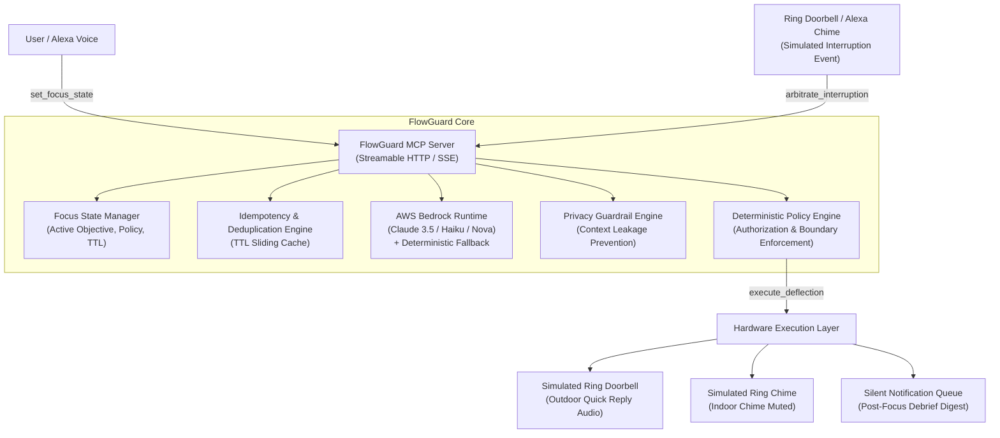

# FlowGuard: Alexa+ Deep-Work Interruption Arbitration Agent

FlowGuard is an intelligent backend arbitration agent designed for deep-work focus protection. Built on Node.js and TypeScript, FlowGuard implements a self-hosted **Model Context Protocol (MCP)** server conforming to MCP specification version **2025-11-25** over **Streamable HTTP (Server-Sent Events)**, coupled with **AWS Bedrock** for contextual LLM arbitration and deterministic application-level safety policy enforcement.

---

## Architecture Overview



---

## Key Capabilities & Safety Guarantees

1. **Protocol-Compliant Self-Hosted MCP Server**:
   - Implements the official `@modelcontextprotocol/sdk` (spec version `2025-11-25`).
   - Serves Streamable HTTP over Server-Sent Events (`GET /sse`) and synchronous message routing (`POST /messages?sessionId=...`).
2. **Deterministic Application Policy Enforcement**:
   - The LLM is **never** permitted to bypass authorization or invent successful execution.
   - Bedrock proposes an action and urgency score; application code strictly enforces `allowedResponses`, `autoDeflectDeliveries`, and explicit user approval constraints.
3. **Sensitive Focus Context Privacy Guardrail**:
   - Strictly enforces that visitor-facing audio (doorbell speakers) **never reveals** the user's focus objective, project details, calendar events, or schedule.
   - If an LLM proposal or caller inquiry attempts to disclose private context, the Privacy Guard intercepts the output, flags a security alert, and substitutes a neutral pre-authorized message.
4. **Idempotency & Deduplication**:
   - Built-in sliding TTL cache tracks `eventId`s.
   - Prevents duplicate doorbell presses or repeated upstream webhooks from re-triggering outdoor speaker audio or distorting audit logs.
5. **AWS Bedrock Integration with Resilient Fallback**:
   - Uses AWS Bedrock Runtime via `ConverseCommand` (`@aws-sdk/client-bedrock-runtime`).
   - Supports Claude 3.5 Sonnet, Claude 3 Haiku, or Amazon Nova models.
   - Seamlessly falls back to high-fidelity deterministic local arbitration if AWS credentials are unconfigured or when running in offline test environments (`BEDROCK_MOCK=true`).
6. **Explicit Hardware Simulation**:
   - Ring doorbell outdoor audio, chime muting, and Alexa Echo announcements are explicitly simulated with structured audit logs unless physical device credentials are authenticated.

---

## MCP Tools Reference

### 1. `set_focus_state`
Establishes the active deep-work focus session and sets deterministic filtering rules.
- **Inputs**:
  - `objective` (string, required): Focus task (e.g. `"Executive Board Financial Modeling"`).
  - `durationMinutes` (integer, default `60`): Duration of focus window.
  - `interruptionPolicy` (enum: `emergency_only`, `urgent_only`, `allow_family`, `lenient`).
  - `allowedResponses` (array of enum: `ring_quick_reply`, `silent_queue`, `alexa_spoken_response`, `emergency_breakthrough`, `auto_text`).
  - `autoDeflectDeliveries` (boolean, default `true`): Automatically deflect package couriers.
  - `privacyMode` (boolean, default `true`): Enforce strict context protection against visitor leaks.
- **Returns**: Confirmation payload with `sessionId`, active time window, and policy snapshot.

### 2. `arbitrate_interruption`
Evaluates an incoming structured interruption event against the active focus state.
- **Inputs**:
  - `eventId` (string, required): Unique identifier for idempotency.
  - `source` (enum: `ring_doorbell`, `alexa_speaker`, `phone_call`, `slack`).
  - `category` (enum: `delivery`, `visitor`, `family_member`, `emergency`, `sales`, `noise`).
  - `visitorName` (string, optional): Identified visitor or courier.
  - `transcription` (string): Audio transcription from Ring doorbell or Alexa speaker.
  - `urgencySignals` (array of string): Physical signals (`carrying_box`, `smoke_detected`, `knocked_loudly`).
- **Returns**:
  - `action`: Proposed action (`DEFLECT_RING_PRESET`, `RING_SPOKEN_DEFLECTION`, `SILENT_QUEUE`, `ALLOW_BREAKTHROUGH`, `IGNORE`).
  - `targetDevice`: Target hardware device.
  - `spokenResponseToVisitor`: Proposed audio text.
  - `urgencyScore`: Score from `1` to `10`.
  - `internalReason`: Contextual reasoning.
  - `requiresUserApproval`: Boolean flag.

### 3. `execute_deflection`
Validates the proposed action against deterministic policy and executes on simulated hardware.
- **Inputs**:
  - `eventId` (string, required): Event ID.
  - `action` (enum): Proposed action.
  - `targetDevice` (enum): Hardware target.
  - `spokenResponseToVisitor` (string, optional): Outdoor speaker message.
  - `internalReason` (string): Audit trail rationale.
  - `urgencyScore` (number): Score 1-10.
  - `requiresUserApproval` (boolean): Whether approval is needed.
  - `userApprovalGranted` (boolean, optional): Flag indicating explicit user consent.
  - `category` (enum): Category for policy context.
- **Returns**:
  - `status`: `EXECUTED` | `REJECTED_UNAUTHORIZED` | `QUEUED_SILENTLY` | `DUPLICATE_IGNORED`.
  - `simulatedHardware`: Dispatched audio, chime mute confirmation, or queued silent reminder.
  - `privacySanitized`: Boolean indicating whether privacy guard redacted sensitive context.
  - `auditLogId`: Unique audit trail ID.

### 4. `get_focus_session_summary`
Retrieves active session state, queued post-focus silent reminders, and recent audit logs.

---

## Quickstart & Installation

### Prerequisites
- Node.js >= 20 (tested on v24.12.0)
- npm >= 10

### 1. Installation
```bash
git clone <repo-url>
cd Amazon_Hackathon
npm install
```

### 2. Configuration
Copy the sample environment file:
```bash
cp .env.example .env
```
Configure your `.env`:
```ini
PORT=3000
HOST=127.0.0.1
LOG_LEVEL=info

# AWS Bedrock configuration (optional - fallback operates deterministically if unconfigured)
AWS_REGION=us-east-1
AWS_ACCESS_KEY_ID=
AWS_SECRET_ACCESS_KEY=
BEDROCK_MODEL_ID=anthropic.claude-3-haiku-20240307-v1:0
BEDROCK_MOCK=false

# Simulation Settings
SIMULATE_RING_DEVICE=true
SIMULATE_ALEXA_SPEAKER=true
```

---

## Running FlowGuard

### Run Automated Tests
Executes the full test suite with Vitest (unit tests, security guardrails, deduplication, and real MCP SSE protocol tests):
```bash
npm test
```

### Run the End-to-End Demo
Executes the complete demonstration: activates focus, connects an official MCP client over SSE, processes a simulated Ring delivery, arbitrates with Bedrock, executes deflection, demonstrates privacy leakage prevention, tests duplicate event suppression, and displays the post-focus summary:
```bash
npm run demo
```

### Build & Run the Standalone Server
```bash
npm run build
npm start
```
The server binds to `http://127.0.0.1:3000`:
- **MCP SSE Endpoint**: `GET /sse`
- **MCP Message Router**: `POST /messages?sessionId=<uuid>`
- **Health & Mode Check**: `GET /health`
- **State & Audit Snapshot**: `GET /state`

---

## Test Results

All 21 test cases across 5 test suites pass cleanly:
```text
 Test Files  5 passed (5)
      Tests  21 passed (21)
   Duration  1.29s

  ✓ test/policyEngine.test.ts (5 tests)
    - Permits delivery deflection when autoDeflectDeliveries is true
    - Downgrades ring spoken deflection if ring_quick_reply not in allowedResponses
    - Downgrades unapproved actions requiring explicit permission
    - Authorizes emergency breakthrough when urgencyScore is 10
    - Rejects unauthorized breakthroughs and downgrades to silent queue
  ✓ test/privacyGuard.test.ts (5 tests)
    - Allows safe neutral delivery drop-off response
    - Detects and sanitizes response leaking objective keywords
    - Detects and sanitizes forbidden phrases ('busy working on', 'confidential')
    - Handles empty/undefined inputs safely
    - Substitutes category-specific safe drop-off fallback
  ✓ test/deduplication.test.ts (2 tests)
    - Tracks and detects duplicate events within sliding window
    - Distinguishes between distinct event IDs
  ✓ test/bedrockArbitrator.test.ts (3 tests)
    - Arbitrates package deliveries with drop-off deflection
    - Arbitrates emergency signals with breakthrough authorization
    - Arbitrates sales solicitations with deflection or silent queue
  ✓ test/mcpProtocol.test.ts (6 tests)
    - Discovers registered MCP tools over Streamable HTTP (SSE)
    - Calls set_focus_state over MCP protocol
    - Calls arbitrate_interruption over MCP protocol
    - Calls execute_deflection and verifies simulated Ring dispatch
    - Blocks duplicate execution and returns DUPLICATE_IGNORED
    - Retrieves session summary and post-focus reminder digest
```

---

## Status and Verification Disclosures

- **MCP Transport**: Verified end-to-end using the official `@modelcontextprotocol/sdk` Client over live Server-Sent Events (`GET /sse`) and HTTP message posts (`POST /messages`).
- **AWS Bedrock Runtime**: Implemented using `@aws-sdk/client-bedrock-runtime` (`ConverseCommand`). When live AWS credentials are provided in `.env`, real Bedrock API calls are made. If credentials are unset or `BEDROCK_MOCK=true`, the system engages the built-in deterministic arbitrator.
- **Ring & Alexa Hardware**: Explicitly simulated. No physical Ring or Echo device hardware is modified or accessed directly.
- **AWS Builder & Open Source Eligibility**: FlowGuard is implemented under the MIT License. AWS Builder eligibility requires deployment to an active AWS account with provisioned Bedrock access.

---

## License

This project is licensed under the [MIT License](LICENSE).
